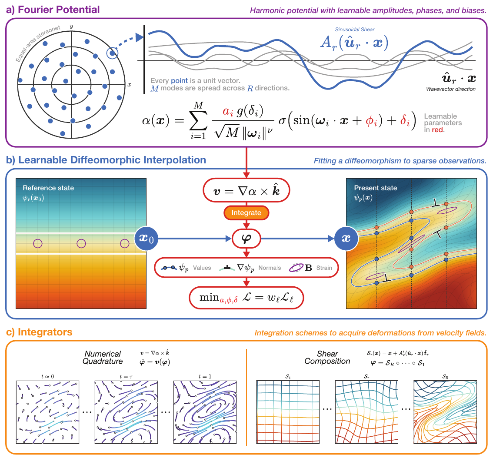

# Learnable Diffeomorphic Interpolation

Notebooks, input data, saved fits and figures for *Topologically and physically constrained geological modelling with Learnable Diffeomorphic Interpolation*.



*Method figure ([`00_method/figures/00_method.pdf`](00_method/figures/00_method.pdf)).*

Each example is one folder. The notebooks run in order: make or load the data, fit, then draw. Saved results are included, so a figure can be redrawn without fitting again. Folders are numbered as in the paper; there is no example 02.

```
README.md
environment.yml
figstyle.py            figure style
diagnostics.py         critical points, ensembles, Surfe helpers, stereonets
exploded3d.py          3-D scenes
render_exploded.py     headless Blender render of one scene
settings_table.py      supplement settings table, from the saved fit settings
<NN_example>/          one main-text example
s<NN_topic>/           one Supplementary Note
  *.ipynb
  data/                field data, digitised data, or a dataset made here
  results/             saved fits: grids, scalars, meshes, model weights
  figures/             pdf and png; figures/supplement/ for the supplement
  renders/             PNG renders and the camera used to compose the 3-D figures
```

Blender scene files (`*.blend`, `*.blend1`) are omitted. Re-running a 3-D figure notebook writes a new one locally. The Hartland data panel is the saved PNG in `05_hartland_quay/renders/data/`. Rebuilding that scene needs the full photogrammetry cloud: set `CLOUD_PLY` in `05e_hartland_quay_figures` and re-run its data section. The 80,000-point cloud used by the fits is in `05_hartland_quay/data/raw/hartland_cloud.npz`.

## Running a notebook

Run each notebook from its own folder. Jupyter does this when you open the notebook. Paths such as `data/` and `results/` are relative to that folder.

Shared modules live in this directory, one level up. The setup cell of each notebook adds it to the import path:

```python
sys.path.insert(0, str(Path("..").resolve()))
```

A fitting notebook writes `results/`. The first fit also saves the evaluation grid (`inputs.npz`), so a later method, including Surfe, uses the same grid. Quick plots shown while fitting are not saved.

A figure notebook reads `results/` and writes `figures/`. The drawn panels need NumPy and Matplotlib. A 3-D panel also needs PyVista, Pillow and Blender. Point `exploded3d.BLENDER` at the Blender executable before rendering; the copy in this repository is a macOS path. The contact-distance cell at the end of `04c_multiwavelength_fold_figures` reloads the saved fits and needs curlew.

`settings_table.py` reads the six main-text `fit_settings` files and prints the supplement's settings table. `python settings_table.py --check` writes nothing.

## Environment

`environment.yml` creates an environment named `curlew` with the packages these notebooks import (Python 3.11; macOS arm64; PyTorch from pip). curlew itself is not on PyPI. These notebooks use the [`dev` branch](https://github.com/samthiele/curlew/tree/dev) of [curlew](https://github.com/samthiele/curlew). Clone that branch, install it, then register the kernel under the name stored in the notebooks:

```
git clone -b dev https://github.com/samthiele/curlew.git
conda env create -f environment.yml
conda activate curlew
pip install -e /path/to/curlew
python -m ipykernel install --user --name curlew_dev
```

| package | used for |
|---|---|
| numpy, torch, tqdm | curlew |
| matplotlib, cmasher | figures |
| pandas | the fold-pair contacts |
| scipy, contourpy, scikit-image | grids, contours, marching cubes |
| pyvista, pillow | 3-D scenes and compositing the renders |
| ipykernel | the notebooks |

Blender is a separate application. Surfe notebooks need `surfepy` as well, in its own environment. They are `01c`, `05c`, `06c` and `07c`. Cells that only score a saved `surfe.npz` do not import it.

## Examples

Notebooks are listed in the order to run them. A letter gap means that notebook was dropped; the remaining ones still run in alphabetical order.

### `01_recumbent_fold` — inclined fold pair, 2-D

`01a_recumbent_fold_data` builds the synthetic fold (`synthetic_fold.py`) and writes `data/synthetic/`. `01b_recumbent_fold_fit` fits one neural field and one LDI model and scores both against the true units. `01c_recumbent_fold_surfe` fits Surfe on the same grid. `01d_recumbent_fold_ensemble` refits LDI from 15 Fourier seeds. `01e_recumbent_fold_figures` draws `fig01_recumbent_fold_synthetic` and `fig02_recumbent_fold_ensemble_synthetic`. Fits are in `results/synthetic/`.

### `03_single_layer` — single layer, 2-D

`03a_single_layer_data` reads `data/single_layer_digitised.svg` and writes the ground truth and the observations. `03b_single_layer_fit` writes `results/fit_settings.json`. `03c_single_layer_ensemble` runs three ensembles of 15: no energy bias, energy bias, and energy bias with the strain prior. `03e_single_layer_strain_prior` writes `results/strain_prior.npz`. `03d_single_layer_figures` draws the main figure and prints the numbers quoted in the text. `03f_single_layer_strain_prior_figures` draws the strain-prior figure. Shared loading is `single_layer_inputs.py`.

### `04_multiwavelength_fold` — multilayer fold train, 2-D

Contacts are `data/big_fold_contacts.csv`, digitised from the Implicit Benchmark `BigFoldDigitized.svg` (also in `data/`). `04a_multiwavelength_fold_data` writes `data/big_fold_observations.npz`. `04b_multiwavelength_fold_fit` fits energy-biased LDI twice, shear then RK4, under `results/shear/` and `results/rk4/`. `04c_multiwavelength_fold_figures` draws both on `fig04_big_fold`. `INTEGRATOR` selects which fit the printed numbers use. Shared loading is `big_fold_inputs.py`.

### `05_hartland_quay` — Hartland Quay, Devon

`data/raw/` holds the traces, bedding and the photogrammetry subsample. `05a_hartland_quay_data` writes `data/processed/` and the supplement data and stereonet figures. Later notebooks read that file through `hartland_inputs.py`. `05b_hartland_quay_ldi` fits 20 Fourier seeds. `05c_hartland_quay_surfe` fits Surfe, builds its meshes and the block hold-out. `05d_hartland_quay_meshes` meshes member 19. `05i_hartland_quay_blocks` writes the block comparison. `05e_hartland_quay_figures` renders member 19, Surfe, and the block figure. `05f_hartland_quay_finalcomp` composes `fig05_hartland_quay_member_19` from those PNGs, cut back from the wave-cut platform to the cliff. `05h_hartland_quay_numbers` prints the ranges and shortening quoted in the text.

### `06_claudius` — Claudius, 3-D seismic

The horizon picks are the Implicit Benchmark Claudius set; see `data/_README.md`. `06a_claudius_data` writes `data/processed/` and the supplement data figure. Later notebooks read it through `claudius_inputs.py`. `06b_claudius_ldi` and `06c_claudius_surfe` both use `SAMPLING = "seismic"` and lines of 5 by 5 plus the bounds, half-width 20 m. Both are saved as `seis5x5b_w20`. `06d_claudius_figures` opens those two meshes as `fig06_claudius_opened_seis5x5b_w20`.

### `07_cylindrical_isocline` — refolded isocline, 3-D

`data/raw/` is the Implicit Benchmark refolded isocline. `07a_cylindrical_isocline_data` writes `data/processed/`, read through `isocline_inputs.py`. `07b_cylindrical_isocline_ldi` fits with `cylindrical=True` and a reference facing −x (`flat_reference.py`). `07c_cylindrical_isocline_surfe` fits Surfe at `ANISOTROPY = 1e5`, saved as `surfe_aniso100000`. `07d_cylindrical_isocline_meshes` meshes the truth, Surfe and LDI. `07e_cylindrical_isocline_ensemble` refits 15 Fourier seeds. `07f_cylindrical_isocline_figures` draws the three slab renders (`SURFE_TAG = "surfe_aniso100000"`).

Surface meshes are plain arrays written by `diagnostics.export_meshes`. A 3-D figure notebook reads those arrays and does not re-evaluate the field.

### `s01_fourier_basis` — Supplementary Note 1

Uses the recumbent fold in `01_recumbent_fold` (`data/synthetic/` and `results/synthetic/fit_settings.json`). `s01a_fourier_basis_directions` writes `results/direction_seeds.npz`, `s01b_fourier_basis_sweeps` writes `results/band_sweep.npz`, and `s01c_fourier_basis_energy_bias` writes `results/energy_bias.npz`. `s01d_fourier_basis_figures` draws the band, direction and energy figures.

### `s02_velocity` — Supplementary Note 2

Same recumbent-fold inputs as Supplementary Note 1. `s02a_velocity_fit` writes `results/velocity.npz`. `s02b_velocity_figures` draws `figS_velocity`.

### `s03_shears` — Supplementary Note 3

`s03a_shears_data` builds `data/disharmonic_fold.npz` from `data/DisharmonicFolds.svg`. `s03b_shears_fit` writes `results/shears.npz`. `s03c_shears_ensemble` writes `results/shears_ensemble.npz`. `s03d_shears_figures` draws the RK4, ray, convergence and sweep figures.
